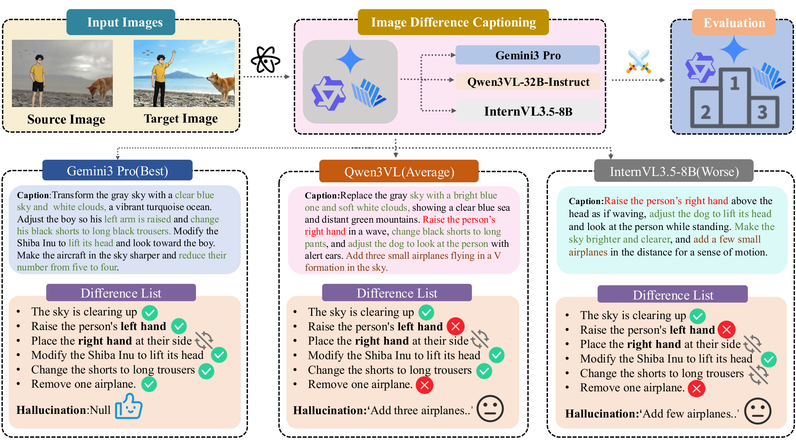
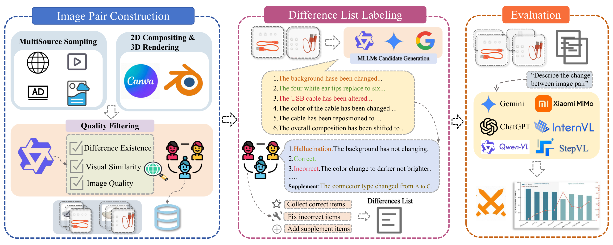
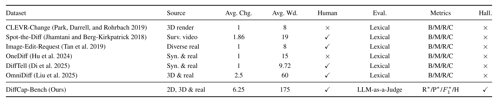
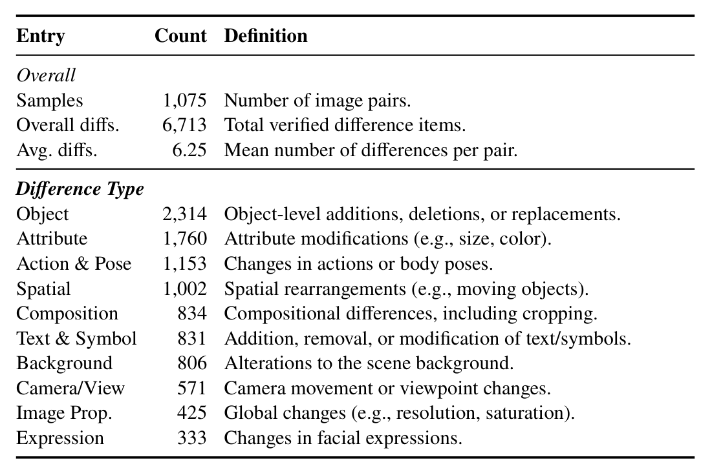
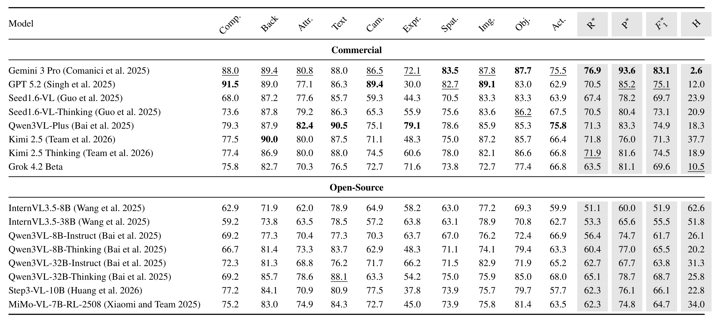
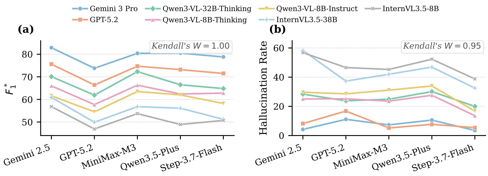
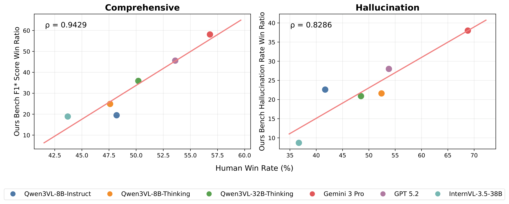
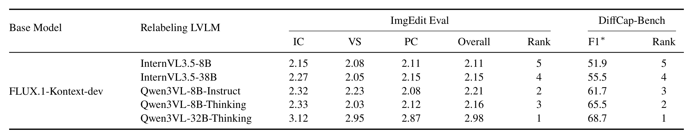
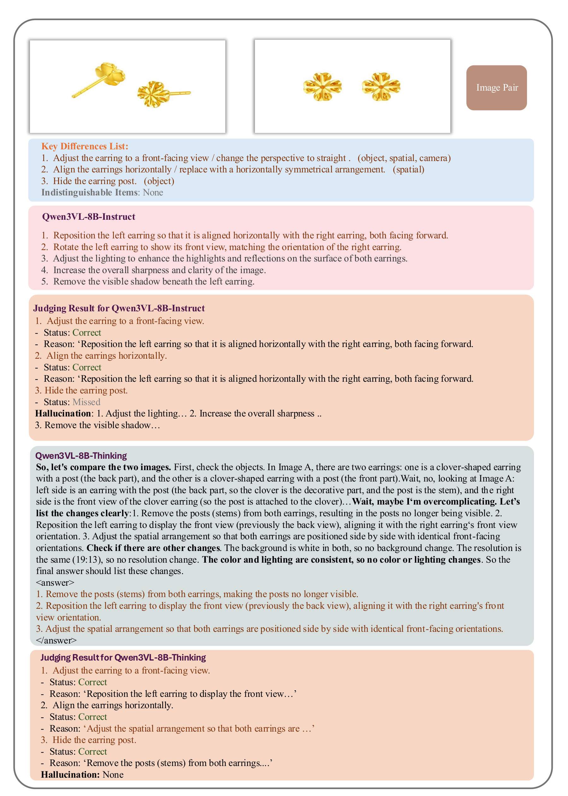
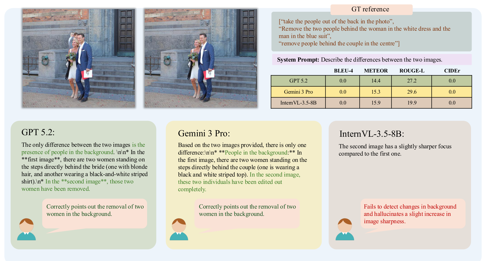

<div align="center">

# DiffCap-Bench: A Comprehensive, Challenging, Robust Benchmark for Image Difference Captioning

**Yuancheng Wei**<sup>1\*</sup>, **Haojie Zhang**<sup>1\*</sup>, **Linli Yao**<sup>2</sup>, **Lei Li**<sup>3</sup>, **Jiali Chen**<sup>1</sup>, **Tao Huang**<sup>4</sup>, **Yiting Lu**<sup>5</sup>, **Duojun Huang**<sup>5</sup>, **Xin Li**<sup>5†</sup>, **Zhao Zhong**<sup>5</sup>

<sup>1</sup>South China University of Technology &nbsp; <sup>2</sup>Peking University &nbsp; <sup>3</sup>The University of Hong Kong

<sup>4</sup>Tianjin University &nbsp; <sup>5</sup>Tencent Hunyuan

<sup>\*</sup>Equal contribution &nbsp; <sup>†</sup>Corresponding author

<a href="https://arxiv.org/abs/2605.04503"></a>
<a href="https://huggingface.co/datasets/wyccccc/DiffCapBench-Data"></a>
<a href="https://github.com/wyclike/DiffCap-Bench"></a>

</div>

## 🔥 News

- **[2026.11]** Benchmark images and saved model predictions / judge outputs are available on [Hugging Face](https://huggingface.co/datasets/wyccccc/DiffCapBench-Data). Inference, judging, and scoring code are included in this repository.

## 📖 Overview

**Image Difference Captioning (IDC)** describes the visual changes between a source image and a target image. DiffCap-Bench evaluates whether MLLMs capture those changes accurately and avoid inventing changes that did not happen.

- 🏆 **Comprehensive and challenging data:** **1,075 image pairs**, **6,713 verified difference items**, and **10 difference categories**, with **6.25 changes per pair** on average. Sources cover real-world images, 2D compositing, and 3D rendering.
- 🔍 **Semantic evaluation:** a bidirectional **LLM-as-a-Judge** protocol checks predictions against human-validated **Difference Lists**, measuring coverage, correctness, and hallucinations beyond lexical overlap.
- 📊 **Systematic validation:** evaluation of **16 MLLMs**, cross-judge ranking analysis, comparison with human judgments, and downstream image-editing experiments.

<p align="center">
  
</p>
<p align="center"><em>Models describe changes from the source image to the target image. The evaluation distinguishes correct hits, incorrect hits, missed changes, and hallucinations.</em></p>

## 🏆 DiffCap-Bench

### Construction Pipeline

<p align="center">
  
</p>
<p align="center"><em>Multi-source image collection and filtering, atomic difference annotation with human review, and Difference List-based evaluation.</em></p>

### Comparison with Existing Benchmarks

<p align="center">
  
</p>
<p align="center"><em>DiffCap-Bench combines diverse image sources and multiple changes per pair with semantic evaluation and explicit hallucination measurement.</em></p>

### Statistics

<p align="center">
  
</p>
<p align="center"><em>The benchmark spans object, attribute, action and pose, spatial, composition, text and symbol, background, camera and viewpoint, image property, and expression changes. One difference item can have multiple category labels.</em></p>

## 🔍 Evaluation Protocol

The judge receives **both images**, the **model prediction**, and the expert **Difference List**:

1. **Forward checking:** label each reference change as **Hit and Correct**, **Hit but Incorrect**, or **Not Hit**.
2. **Backward checking:** examine additional predicted changes and distinguish **Extra Correct Descriptions**, **Matches Uncertain Change List**, and **Hallucinations**.

Let **C** be correctly hit items, **I** incorrectly hit items, **N** reference key items, and **H** hallucinated items:

| Metric | Formula | Measures |
| :--- | :--- | :--- |
| Recall ↑ | `C / N` | Coverage of reference changes |
| Precision ↑ | `C / (C + I + H)` | Correctness with a hallucination penalty |
| F1 ↑ | `2C / (N + C + I + H)` | Balance between coverage and correctness |
| Hallu ↓ | `H / N` | Hallucinations relative to reference difference density |

Extra correct descriptions and uncertain changes receive neither credit nor a penalty. An incorrect hit is not counted again as a hallucination. Hallu can exceed 100% because its denominator is the reference-item count.

## 📊 Main Results

### Results on DiffCap-Bench

<p align="center">
  
</p>
<p align="center"><em>Results for 16 proprietary and open-source MLLMs. Scores are percentages; higher Recall, Precision, and F1 and lower Hallu indicate stronger performance. Full predictions and judge outputs are hosted on Hugging Face.</em></p>

### Cross-Judge Ranking Consistency

<p align="center">
  
</p>
<p align="center"><em>Seven representative MLLMs evaluated by five independent judges. Rankings remain stable despite differences in absolute scores: Kendall's W = 1.00 for F1 and 0.95 for Hallu.</em></p>

### Alignment with Human Judgment

<p align="center">
  
</p>
<p align="center"><em>Model-level win-rate rankings on 100 human-rated image pairs align with human judgments: Spearman's ρ = 0.9429 for F1 and 0.8286 for Hallu.</em></p>

### Correlation with Downstream Image Editing

<p align="center">
  
</p>
<p align="center"><em>FLUX.1-Kontext-dev is fine-tuned on the same 300K image pairs relabeled by different MLLMs, then evaluated on 500 held-out pairs. DiffCap-Bench F1 rankings correlate with downstream editing scores (Spearman's ρ = 0.90).</em></p>

### Case Studies

<details>
<summary>📌 Reasoning and fine-grained difference captioning</summary>

<p align="center">
  
</p>
<p align="center"><em>A comparison of Qwen3VL-8B-Instruct and Qwen3VL-8B-Thinking on the same image pair, including their judge outputs.</em></p>

</details>

<details>
<summary>📌 Why lexical-overlap metrics can miss semantic differences</summary>

<p align="center">
  
</p>
<p align="center"><em>Semantically accurate captions can receive low lexical-overlap scores when their wording differs from the reference.</em></p>

</details>

## 🛠️ Installation

```bash
git clone https://github.com/wyclike/DiffCap-Bench.git
cd DiffCap-Bench

# Optional: create an isolated Python environment.
conda create -n diffcap python=3.10 -y
conda activate diffcap

pip install openai Pillow requests pyyaml tqdm huggingface_hub
```

Inference and judging use **OpenAI-compatible multimodal APIs**. Scoring saved judge outputs uses only the Python standard library and makes no API calls.

## 📂 Repository Structure

```text
DiffCap-Bench/
├── assets/                       # Figures used in this README
├── Data/
│   └── test.csv                  # Image-pair metadata and expert annotations
├── inference/
│   └── run_inference.py          # Generate difference captions
├── judge/
│   └── judge.py                  # Judge model predictions
├── prompt/
│   ├── inference.yaml            # Caption-generation prompt
│   └── judge.yaml                # Difference List-based judge prompt
├── score.py                      # Compute metrics from saved judge outputs
├── images/                       # Download benchmark images from Hugging Face
├── Result/                       # Download saved results from Hugging Face
├── outputs/                      # Generated inference / judge CSV files
└── score_results/                # Generated metric summaries and diagnostics
```

`images/` and `Result/` are hosted on Hugging Face and are excluded from Git, together with generated outputs.

## 🚀 Evaluation on DiffCap-Bench

### 1. Download the Data First

Run these commands from the **code repository root** to download [`wyccccc/DiffCapBench-Data`](https://huggingface.co/datasets/wyccccc/DiffCapBench-Data):

```bash
# Benchmark images.
hf download wyccccc/DiffCapBench-Data \
    --repo-type dataset \
    --include "images/*" \
    --local-dir .

# Saved model predictions and judge outputs.
hf download wyccccc/DiffCapBench-Data \
    --repo-type dataset \
    --include "Result/*" \
    --local-dir .
```

The dataset is public. These commands place `images/` and `Result/` directly in the repository root, while preserving the code README and `Data/test.csv`.

Keep `Data/test.csv` from this repository. Its `src_url` and `tgt_url` values are relative paths such as `images/<relation_id>_src.jpeg` and `images/<relation_id>_tgt.jpeg`. Run the following commands from the repository root so those paths resolve correctly.

**To recompute saved results without new API calls**, only the `Result/` download is needed:

```bash
python score.py --input Result --output-dir score_results --allow-invalid
```

### 2. Generate Difference Captions

Set the credentials for your inference API, then choose a model supported by that API:

```bash
export OPENAI_API_KEY="YOUR_API_KEY"
export OPENAI_BASE_URL="https://YOUR_API_HOST/v1"

python inference/run_inference.py \
    --csv_file ./Data/test.csv \
    --result_dir ./outputs \
    --model YOUR_VLM_MODEL_ID \
    --col inference_result \
    --max_workers 8
```

Predictions are saved to `outputs/result_<timestamp>.csv`.

### 3. Judge the Predictions

Use the credentials and endpoint for your judge provider. Gemini 2.5 Pro is the default judge in the paper; replace the model ID if using another compatible judge.

```bash
python judge/judge.py \
    --csv_file "./outputs/result_<timestamp>.csv" \
    --result_dir ./outputs \
    --model gemini-2.5-pro \
    --pred_col inference_result \
    --keypoint_col keypoint_list_with_dimension \
    --col judge_result \
    --max_workers 8
```

Replace `<timestamp>` with the actual inference filename. Both API stages accept `--api_key` and `--base_url`, or read `OPENAI_API_KEY` and `OPENAI_BASE_URL` from the environment. Judge outputs are saved to `outputs/judge_<timestamp>.csv`.

### 4. Compute Metrics

```bash
python score.py \
    --input "./outputs/judge_<timestamp>.csv" \
    --pred-col inference_result \
    --output-dir score_results
```

| Output | Contents |
| :--- | :--- |
| `summary.json` | Overall metrics, category F1, sample counts, and scoring configuration |
| `summary.md` | A summary table with scores shown as percentages |
| `<input_stem>.samples.jsonl` | Per-pair counts, metrics, warnings, and validation errors |

Use `--allow-invalid` when inspecting saved runs with missing or invalid records. The script reports the scored subset and flags incomplete runs explicitly; it exits with status 2 on invalid records unless this option is set.

<details>
<summary>⚙️ Dataset fields and additional scoring options</summary>

`Data/test.csv` contains 1,075 rows:

| Column | Description |
| :--- | :--- |
| `relation_id` | Unique image-pair identifier |
| `src_url` / `tgt_url` | Relative source / target image paths under `images/` |
| `src_aspect_ratio` / `tgt_aspect_ratio` | Image-size and aspect-ratio metadata |
| `keypoint_list_with_dimension` | Expert key differences and uncertain changes, with category labels |

Useful inference / judging options:

| Option | Description |
| :--- | :--- |
| `--prompt_yaml` | Use a custom prompt template |
| `--start_point` / `--end_point` | Process a row range; the end index is exclusive |
| `--max_workers` | Number of concurrent API requests |
| `--api_key` / `--base_url` | Override API credentials and endpoint |

Useful scoring options:

| Option | Default | Description |
| :--- | :--- | :--- |
| `--dataset` | `Data/test.csv` | Reference annotations, matched by `relation_id` |
| `--pred-col` | Auto-detect | Prediction column; set to `inference_result` for generated CSV files |
| `--judge-col` | `judge_result` | Column containing the saved judge output |
| `--category-average` | `micro` | Pool category counts (`micro`) or average per-pair category F1 (`macro`) |
| `--hallu-source` | `summary` | Use the saved hallucination summary, the extra-item list, or reject inconsistent counts (`strict`) |
| `--allow-invalid` | Off | Permit valid-subset summaries for incomplete runs |

Overall metrics are averaged per image pair. Multi-label items count once in each assigned category and once overall. An explicitly empty prediction receives zero on all metrics; missing or malformed results are recorded as invalid. Scoring accepts English and historical Chinese judge fields, including JSON and Python-literal payloads.

</details>

## 📝 Citation

If you find DiffCap-Bench useful, please cite our paper:

```bibtex
@article{wei2026diffcapbench,
  title   = {DiffCap-Bench: A Comprehensive, Challenging, Robust Benchmark for Image Difference Captioning},
  author  = {Wei, Yuancheng and Zhang, Haojie and Yao, Linli and Li, Lei and Chen, Jiali and Huang, Tao and Lu, Yiting and Huang, Duojun and Li, Xin and Zhong, Zhao},
  journal = {arXiv preprint arXiv:2605.04503},
  year    = {2026},
  url     = {https://arxiv.org/abs/2605.04503}
}
```
